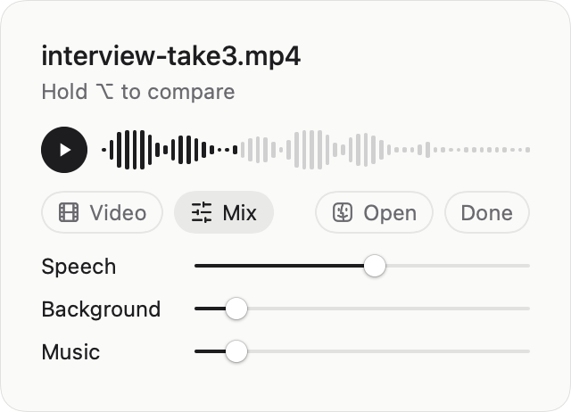

# Booth

**Studio-quality voice for your recordings, enhanced on your Mac.**

[Website](https://getbooth.vercel.app) · [Download for Mac](https://github.com/shrimbly/booth/releases/latest/download/Booth.dmg) · `brew install shrimbly/booth/booth`

<picture>
  <source media="(prefers-color-scheme: dark)" srcset="docs/images/booth-dark.png">
  
</picture>

Booth cleans up the voice in any video or audio file. It lives in the menu bar: drop a recording on
it and `<name>-enhanced` appears beside the original, with the voice restored, the room and the
noise turned down, and the picture left as it was. It is the same kind of model as Adobe Podcast's
Enhance Speech, and it runs entirely on your Mac. There is no account, no upload and no length limit.

Under the app is the `booth` command, which you can use on its own:

```console
$ booth interview.mp4 podcast.wav
✓ interview.mp4 → interview-enhanced.mp4 (1m 48s)
✓ podcast.wav → podcast-enhanced.wav (52s)
```

- [Install](#install): the disk image, Homebrew, or the command line on its own
- [Use Booth](#use-booth)
- [Use the command line](#use-the-command-line)
- [How it works](#how-it-works)
- [Build and release](#build-and-release)

## Requirements

- macOS 14 (Sonoma) or later on Apple silicon, with 16 GB of memory or more. The voice model needs
  about 12 GB while it works, however long the recording.
- About 3 GB of disk space for the voice models and the engine, downloaded on first use.
- [ffmpeg](https://ffmpeg.org), to read and write audio and video. Homebrew installs it with Booth.

## Install

### Download

Download `Booth.dmg` from the [website](https://getbooth.vercel.app) (or the
[latest release](https://github.com/shrimbly/booth/releases/latest)), open it, and drag Booth to
Applications. Then open Booth from Applications. It lives in the menu bar, not in the Dock.

The first time, Booth sets up its engine and downloads the voice models: about 1.1 GB, once. If
you don't have ffmpeg, install it with [Homebrew](https://brew.sh): `brew install ffmpeg`.

To use `booth` in Terminal as well, link the copy inside Booth onto your `PATH`:

```bash
ln -s /Applications/Booth.app/Contents/Resources/bin/booth /usr/local/bin/booth
```

### Homebrew

```bash
brew install shrimbly/booth/booth
```

This installs Booth from its [tap](https://github.com/shrimbly/homebrew-booth), puts `booth` on
your `PATH`, and installs ffmpeg. `brew upgrade` keeps both up to date, and
`brew uninstall --cask --zap booth` also removes the models and settings.

### Command line only

Without the app, install the `booth` command with [uv](https://docs.astral.sh/uv/):

```bash
brew install uv ffmpeg
uv tool install --python 3.11 git+https://github.com/shrimbly/booth   # or `.` from a checkout
booth setup                                                           # optional: download the models now
```

The engine needs Python 3.11 or 3.12; `--python 3.11` makes uv fetch one if you don't have it.

### From source

```bash
git clone https://github.com/shrimbly/booth && cd booth
uv sync --python 3.11                       # the engine, in .venv
app/scripts/build-app.sh --open             # Booth.app, using this checkout's engine
```

Building Booth needs the Command Line Tools for Xcode (`xcode-select --install`), not Xcode itself.
See [app/README.md](app/README.md) for the details.

## Use Booth

Give Booth a recording in whichever way is handy:

- Drop the file on the menu bar icon, or into the open popover.
- Select files in Finder and press **⌃⌥E**.
- Right-click files in Finder and choose **Quick Actions › Enhance with Booth**.
- Choose **Open With › Booth**.

Booth works through files one at a time and writes `<name>-enhanced` next to each. When one is
done, play it in the popover and hold **⌥** to hear the original. **Mix** sets how much speech,
background and music to keep. You hear each change as you make it, and saving a new mix takes
seconds, because the voice models don't run again.

[app/README.md](app/README.md) covers settings, logs and troubleshooting.

## Use the command line

```bash
booth talk.mp4                    # writes talk-enhanced.mp4 and talk-enhanced.wav
booth *.mov                       # several files, one after another
booth talk.mp4 -s 80 -b 0 -m 0    # stronger voice, no background, no music
booth podcast.wav -o clean.wav    # choose the output
booth talk.mp4 --engine df3       # fastest: removes noise without restoring the voice
booth talk.mp4 --stems-dir stems  # keep stems, then…
booth remix stems -b 25           # …change the mix in a second or two
```

Progress, messages and errors go to stderr, and each finished file's path goes to stdout, so
`booth *.mov | xargs open` opens the results. Ctrl-C stops cleanly. Results are written only
when a file is completely done, so a stopped or failed run leaves nothing half-written behind.

For a video, the enhanced sound goes into a copy of the same container (`.mp4`, `.mov`, `.mkv`,
`.webm`…). The picture is copied losslessly; `--crf N` re-encodes it instead. Subtitles, other
audio tracks, the recording date and location come along where the container allows. The enhanced
`.wav` is always written as well. `booth` refuses any output, or kept stem, that would
replace the input file.

`booth remix DIR` replaces the outputs the stems were made with, or writes to `-o PATH`
instead. If the original video has moved, `-o new.wav` still renders the audio.

The first run downloads the voice models it needs (about 1.1 GB) before it starts.
`booth setup` does that ahead of time, and `booth setup --check` reports what is
missing.

### Options

| Option | Default | |
|---|---|---|
| `-s`, `--speech 0-100` | 54 | Enhancement strength |
| `-b`, `--background 0-100` | 10 | Room tone and other background sound |
| `-m`, `--music 0-100` | 10 | Music |
| `-o`, `--output PATH` | `<input>-enhanced.<ext>` | Where to write: a file name, or a folder for the default name (one input only) |
| `--audio-only` | off | Write only the `.wav`, not a new video |
| `--crf N` | copy | Re-encode the video at CRF N |
| `--stems-dir DIR` | — | Keep preview stems for `booth remix DIR` (one input only) |
| `--keep-stems DIR` | — | Write the clean, background and music stems for inspection (one input only) |
| `--engine` | `sidon` | `sidon` restores the voice; `mossformer2` and `df3` only remove noise (`df3` is fastest). If it can't run, the next one is used and the result line says so |
| `--no-split` | off | Skip music separation: about twice as fast, the music level does nothing |
| `--device` | `cpu` | `mps` or `auto` for music separation |
| `-v`, `--verbose` | off | Log each processing step and its timing |
| `-q`, `--quiet` | off | No progress; print only the finished files, errors and engine fallbacks |

`booth enhance --help` lists the fine-tuning switches (`--no-declick`, `--no-smooth`,
`--lufs N` from −70 to −5, and others). [How it works](docs/how-it-works.md) explains what each one does.

| Exit status | Meaning |
|---|---|
| 0 | Every file was enhanced |
| 1 | At least one file failed; the others were still written |
| 2 | The command line was wrong |
| 130 | Stopped with Ctrl-C |

Set `BOOTH_DEBUG=1` to see the full error behind a one-line failure message.

### Speed

A 3-minute video takes about 1.8 minutes on an M5 Pro: music separation and voice restoration take
about 40% each. `--no-split` roughly halves that when the recording has no music.

## How it works

```
original ──Sidon (generative restoration)──▶ studio speech ─▶ tone + gate ─┐
original ──demucs──▶ vocals ──DeepFilterNet3──▶ speech key + background    ├─▶ mix
                     music ────────────────────────────────────────────────┘
```

The voice comes from **Sidon** ([sarulab-speech/sidon-v0.1](https://huggingface.co/sarulab-speech/sidon-v0.1)),
a generative speech-restoration model. Rather than subtracting noise, it predicts clean speech
features and resynthesizes 48 kHz studio speech from them, so it rebuilds bandwidth and harmonics
that a denoiser can only muffle. Demucs separates the music, and DeepFilterNet3 marks where speech
is, so the pauses between words can be brought down without clipping word onsets.

Measured against Adobe Podcast Enhance v2 on four real recordings:

| | DNSMOS OVR | UTMOS | Spectral distance to Adobe |
|---|---|---|---|
| Original | 2.46 | 2.05 | 9.6 dB |
| **Booth (Sidon)** | **3.37** | **3.56** | **6.2 dB** |
| Adobe Podcast | 3.35 | 3.60 | — |

[docs/how-it-works.md](docs/how-it-works.md) has the full pipeline, the post-processing and why
each step is there, the calibration of the other engines, and the benchmark.
[docs/app-protocol.md](docs/app-protocol.md) describes how Booth drives the engine.

## Build and release

| Script | What it does |
|---|---|
| `app/scripts/build-app.sh` | Builds `app/build/Booth.app`. Add `--dist` for a build meant for other Macs, `--sign IDENTITY` to sign with a Developer ID. |
| `app/scripts/make-dmg.sh` | Packages a built app as `Booth-<version>.dmg`; `--sign` and `--notarize` sign and notarize the image. |
| `app/scripts/release.sh` | Runs the tests, then builds, signs, notarizes and packages a release into `dist/`. `--publish` uploads it to GitHub and updates the Homebrew tap. |
| `app/scripts/set-release-secrets.sh` | Puts the signing certificate, the notary key and the tap's deploy key into the secrets the release workflow uses. |
| `site/tools/make-demo.py` | Rebuilds the website's before/after demo from two recordings. |
| `site/tools/make-demo-video.sh` | Renders the website's demo video from Booth's real popover views. |

The version comes from `pyproject.toml` (with `__version__` in `src/booth/__init__.py` to
match); the build stamps it into Booth's `Info.plist`.

### Make a release

1. Set `version` in `pyproject.toml` and `__version__` in `src/booth/__init__.py`, and commit.
2. Tag the commit `v<version>` and push both:

   ```bash
   git tag v0.2.0 && git push origin main v0.2.0
   ```

The tag starts the **Release** workflow (`.github/workflows/release.yml`). On a GitHub Apple
silicon runner it runs the tests, builds Booth, signs it with the Developer ID, and notarizes and
staples the disk image. Then it uploads `Booth-<version>.dmg`, `Booth.dmg` and `SHA256SUMS` to the
GitHub release `v<version>`, and commits the new cask to
[shrimbly/homebrew-booth](https://github.com/shrimbly/homebrew-booth). `Booth.dmg` is the same
image under a name that doesn't change, for the website's download link. To try the workflow
without releasing anything, run it from the Actions tab: it builds, signs and notarizes, and keeps
the image as a workflow artifact.

The same release can be made on your Mac, if the workflow can't run:

```bash
app/scripts/release.sh --sign "Developer ID Application" --notarize booth --publish
```

`--publish` needs a clean checkout whose commit is on GitHub. It creates the release and its tag at
that commit if they don't exist yet, publishes the release once the images are up, and then
updates the tap. The workflow that the new tag starts sees the release is already published and
stops there. `booth` is a notarytool profile, saved once with an
[App Store Connect API key](https://appstoreconnect.apple.com/access/integrations/api):

```bash
xcrun notarytool store-credentials booth --key AuthKey_<KEY ID>.p8 --key-id <KEY ID> --issuer <ISSUER ID>
```

Without `--sign`, `release.sh` makes an unsigned test image that Gatekeeper blocks on other Macs.

### Signing

Booth is signed with the hardened runtime. `--dist` builds don't point at this checkout's engine,
and they carry no file paths from the Mac that built them. On first run they install their own in
`~/Library/Application Support/Booth/engine` with the bundled `uv`, and they update it the first
time a newer Booth starts.

The workflow signs and notarizes with six repository secrets. `set-release-secrets.sh` checks each
one and sets it:

```bash
app/scripts/set-release-secrets.sh --identity "Developer ID Application" \
  --api-key AuthKey_<KEY ID>.p8 --issuer <ISSUER ID> --tap-key
```

`--identity` exports the certificate and its private key from your keychain as a `.p12` with a new
random password; macOS asks for your login password first. `--api-key` is the key notarization
uses. `--tap-key` makes the SSH key that lets the workflow push to the tap, and adds it to the tap
as a deploy key. Each works on its own, so after renewing the certificate, run just `--identity`.

### Website

`site/` is a single static page: one sentence with a player for a 30-second before/after clip
(hold ⌥ to hear the original) and a short video of Booth at work behind "menu bar". To try it,
open `site/index.html`, or serve the folder with `python3 -m http.server -d site`. Vercel deploys
it to [getbooth.vercel.app](https://getbooth.vercel.app) from every push to `main` (the project's
root directory is `site/`; `site/.vercelignore` keeps `tools/` off the web). The download button
links to `Booth.dmg` on the latest GitHub release. The link-preview card, `site/assets/og.png`, is
`site/tools/og-card.html` rendered by Chrome; the command is at the top of that file.
To replace the before/after clip:

```bash
python3 site/tools/make-demo.py original.wav enhanced.wav --start 12 --length 30
```

The video is drawn by Booth itself, from its real popover views, so re-render it after the UI
changes. Build the app first (`swift build` in `app/`); `DEMO_POSTER` is a still from the video
being dragged, which the file's thumbnail and the Done screen show:

```bash
DEMO_POSTER=still.jpg site/tools/make-demo-video.sh
```

## License

MIT; see [LICENSE](LICENSE). Booth.app also carries uv (MIT or Apache 2.0) and the Geist Serif
typeface (SIL Open Font License), and the engine downloads these models under their own licenses:
Sidon and w2v-BERT 2.0 (MIT), Demucs (MIT), DeepFilterNet (MIT or Apache 2.0) and ClearVoice
MossFormer2 (Apache 2.0). [THIRD_PARTY_NOTICES.md](THIRD_PARTY_NOTICES.md) has the details, and the
app has a copy of it and of `LICENSE` in `Contents/Resources`.
